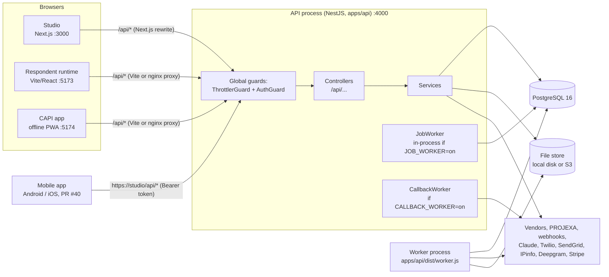
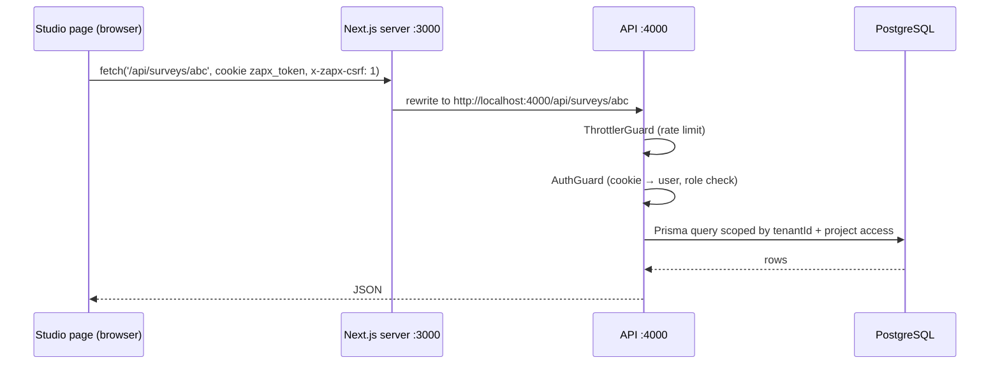
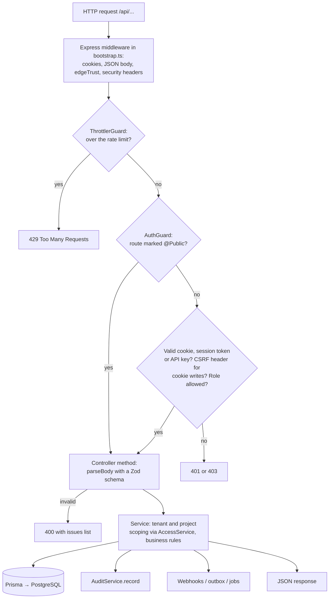
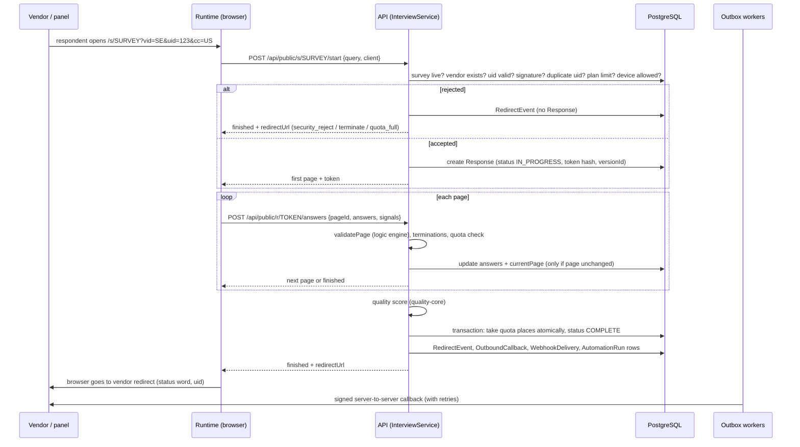
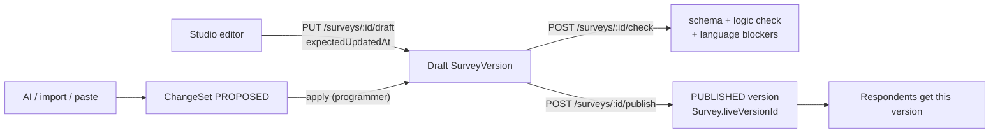

# Architecture

How ZAPX is put together and how a request travels through it. Code references are to branch
`mobile-app` (PR #40, the top of the open stack). For the reasons behind each decision, read the ADRs in
[docs/adr](../adr/README.md); this file describes what the code does.

## 1. Project overview

### What the application does

ZAPX is a survey programming, testing, hosting and fieldwork platform for market research.

| Who                                           | Uses                                                                               | To                                                                                                  |
| --------------------------------------------- | ---------------------------------------------------------------------------------- | --------------------------------------------------------------------------------------------------- |
| Research team (admins, programmers, viewers)  | the **studio** (`apps/studio`), a Next.js web app on port 3000                     | build and publish surveys, manage vendors, review quality, analyse data, configure the organization |
| Respondents                                   | the **runtime** (`apps/runtime`), a small React app on port 5173                   | answer a survey from a vendor link or an email/SMS invitation                                       |
| Field interviewers (CAPI)                     | the **interviewer app** (`apps/capi`), an installable offline web app on port 5174 | run face-to-face interviews without a connection and sync later                                     |
| Phone interviewers (CATI)                     | the studio's **Calls** page (`apps/studio/app/calls/page.tsx`) and the runtime     | work a call list, run the interview, record the call outcome                                        |
| Sample vendors and partners (PROJEXA, panels) | redirects, server-to-server callbacks, the vendor API, webhooks                    | receive outcomes and reconcile                                                                      |
| Other systems                                 | the REST API with an API key, SCIM, webhooks                                       | automate, provision users, receive events                                                           |

### Main modules

| Module                               | What it does                                                                                                                              | Main code                                                                                                                                |
| ------------------------------------ | ----------------------------------------------------------------------------------------------------------------------------------------- | ---------------------------------------------------------------------------------------------------------------------------------------- |
| Accounts and organizations           | sign-up, sign-in, sessions, roles, team, project access, lockout                                                                          | `apps/api/src/auth`, `users`, `projects/members.controller.ts`, `common/access.service.ts`                                               |
| Survey studio                        | definition editing (visual, JSON, XML code view), logic check, preview, publish, versions                                                 | `apps/api/src/surveys`, `packages/survey-schema`, `packages/logic-engine`, `apps/studio/components/VisualEditor.tsx`                     |
| AI architect and imports             | AI-drafted or file-imported changes as reviewable change sets                                                                             | `apps/api/src/ai`, `imports`, `changesets`                                                                                               |
| QA laboratory                        | simulated respondents, coverage, defects, saved test cases                                                                                | `apps/api/src/qa`, `packages/logic-engine/src/simulate.ts`                                                                               |
| Experience and languages             | themes, translations with human review, glossary, translation memory, devices                                                             | `packages/survey-schema` (presentation), `apps/api/src/surveys/translate*.ts`                                                            |
| Hosting (respondent interview)       | entry, routing, validation, terminations, quotas, completion                                                                              | `apps/api/src/interview`, `quotas`, `apps/runtime`                                                                                       |
| Redirect and vendor integration      | outcome redirects, callbacks outbox, PROJEXA adapter, vendor API, webhooks                                                                | `apps/api/src/integrations`, `packages/redirect-core`                                                                                    |
| Data quality and fraud               | 0–100 score per complete, review queue, fraud signals, block list, network reputation                                                     | `apps/api/src/quality`, `packages/quality-core`                                                                                          |
| CAPI (face to face)                  | offline app, sync with server replay, GPS, recordings, evidence, back-checks, appeals                                                     | `apps/capi`, `apps/api/src/capi`, `captures`, `fieldwork`                                                                                |
| CATI (phone)                         | call lists, queue, dispositions, calling hours, do-not-call, Twilio dialer                                                                | `apps/api/src/cati`                                                                                                                      |
| Distribution                         | contacts, email (SendGrid) and SMS (Twilio) invitation waves, reminders, unsubscribe                                                      | `apps/api/src/distribution`                                                                                                              |
| Data, analysis and reports           | CSV/Excel export, frequencies, crosstabs with significance, weighting, saved reports, dashboards, MaxDiff/conjoint, AI research assistant | `apps/api/src/exports`, `analysis`, `packages/analysis-core`                                                                             |
| Background jobs and files            | job queue in PostgreSQL, worker process, local disk or S3 file store, housekeeping                                                        | `apps/api/src/jobs`, `apps/api/src/worker.ts`                                                                                            |
| Enterprise                           | API keys, audit log, SSO (OIDC and SAML), SCIM, plans and Stripe billing                                                                  | `apps/api/src/enterprise`, `auth/sso*`, `auth/saml.service.ts`, `scim`, `plans`                                                          |
| Automation and governance _(PR #34)_ | rules (trigger → conditions → actions), notifications, residency, retention erasure                                                       | `apps/api/src/automation`, `governance`                                                                                                  |
| Design system _(PR #27/#29/#39)_     | studio themes, appearance preferences, sidebar shell, dashboard, neon `PageHeader` on every page, neon CAPI palette                       | `packages/quantum`, `apps/studio/components/quantum`, `components/Shell.tsx`, `apps/studio/app/neon-pages.css`, `apps/api/src/dashboard` |
| Platform integrations _(PR #38)_     | Claude, IPinfo, Deepgram, Twilio, Stripe and S3 keys set in Settings → Integrations, sealed in the database, environment as fallback      | `apps/api/src/platform/integration-settings.service.ts`, `integrations.ts`, `apps/studio/app/settings/integrations`                      |
| Super admin _(PR #41)_               | organizations, subscription plans, web and mobile features per organization and member, suspension, activity, platform automation         | `apps/api/src/super-admin`, `apps/studio/app/super-admin`                                                                                |
| Mobile app _(PR #40)_                | Android and iOS app (Expo) with the CRM's screens, gated live by the mobile features; CAPI inside a WebView                               | `apps/mobile`, `apps/api/src/mobile`                                                                                                     |
| Eye tracking _(PR #37)_              | experimental webcam eye-tracking question (`eyetrack`) and its heat map in analysis                                                       | `packages/survey-renderer`, `apps/api/src/analysis`                                                                                      |

### Technologies

| Layer             | Technology (version from `package.json`)                                                                                                                                       |
| ----------------- | ------------------------------------------------------------------------------------------------------------------------------------------------------------------------------ |
| Language          | TypeScript 5.8 everywhere (strict), Node.js 22                                                                                                                                 |
| Monorepo          | pnpm 10.28 workspaces (`pnpm-workspace.yaml`) and Turborepo 2.5 (`turbo.json`)                                                                                                 |
| Backend           | NestJS 11 on Express (`apps/api`), Zod 4 for validation, `@nestjs/throttler` for rate limits, `@nestjs/jwt` for sessions                                                       |
| Database          | PostgreSQL 16 through Prisma 6.10 (`packages/db`)                                                                                                                              |
| Studio            | Next.js 15.5 (App Router, all pages are client components), React 19.1, CodeMirror 6, lucide-react icons, Geist fonts, plain CSS with custom properties (no Tailwind)          |
| Runtime, CAPI app | Vite 6 + React 19 (static files served by nginx in production); CAPI uses a service worker and IndexedDB                                                                       |
| Mobile app        | Expo SDK 58 with Expo Router, React Native, `expo-secure-store` for the token; its own npm project and lockfile in `apps/mobile`, outside the pnpm workspace _(PR #40)_        |
| Shared logic      | `@zapx/survey-schema`, `@zapx/logic-engine`, `@zapx/survey-renderer`, `@zapx/redirect-core`, `@zapx/quality-core`, `@zapx/analysis-core`, `@zapx/quantum` (all in `packages/`) |
| Files             | local disk (`FILES_DIR`) or AWS S3 (`@aws-sdk/client-s3`)                                                                                                                      |
| Excel, Word, SAML | exceljs, mammoth (Word to text), `@node-saml/node-saml`, `jose` (OIDC tokens)                                                                                                  |
| Tests             | Vitest 3 (unit and API tests with Supertest), Playwright 1.63 (end-to-end)                                                                                                     |
| Infrastructure    | Docker (`Dockerfile`, `docker-compose.yml`), nginx, Terraform for AWS (`infra/terraform`)                                                                                      |

### Third-party services (all optional, all off by default)

From PR #38 the provider keys (Claude, IPinfo, Deepgram, Twilio, Stripe, S3) can be set in the studio
under **Settings → Integrations** (or the super admin console's Integrations page). A value saved there
wins over the environment variable in the "Switch" column, which stays as a fallback. Each process
re-reads the saved values every `INTEGRATIONS_REFRESH_MS` (15 s). SendGrid, SSO and PROJEXA are not
part of it.

| Service                    | Used for                                         | Switch                               | Code                                                  |
| -------------------------- | ------------------------------------------------ | ------------------------------------ | ----------------------------------------------------- |
| Anthropic Claude           | AI architect, AI translation, research assistant | `ANTHROPIC_API_KEY` + `AI_MODEL`     | `apps/api/src/ai/claude.provider.ts`                  |
| AWS S3 (+ KMS)             | file storage                                     | `FILE_STORE=s3`                      | `apps/api/src/jobs/file-store.ts`                     |
| OpenID Connect / SAML IdP  | single sign-on                                   | per organization in Settings         | `apps/api/src/auth/sso.service.ts`, `saml.service.ts` |
| Stripe                     | plan billing                                     | `BILLING=stripe`                     | `apps/api/src/plans/billing.service.ts`               |
| IPinfo                     | VPN / proxy / data-centre check                  | `NETWORK_REPUTATION=ipinfo`          | `apps/api/src/quality/network-reputation.service.ts`  |
| Deepgram                   | transcripts of recordings                        | `TRANSCRIPTION=deepgram`             | `apps/api/src/captures/transcription.service.ts`      |
| Twilio Voice               | CATI dialer and call recording                   | `TELEPHONY=twilio`                   | `apps/api/src/cati/telephony.service.ts`              |
| Twilio Messages _(PR #34)_ | SMS invitations                                  | `SMS_PROVIDER=twilio`                | `apps/api/src/distribution/sms.ts`                    |
| SendGrid _(PR #32)_        | email invitations and automation emails          | `EMAIL_PROVIDER=sendgrid`            | `apps/api/src/distribution/mailer.ts`                 |
| PROJEXA                    | partner redirect and S2S outcome contract        | per vendor (`integration = PROJEXA`) | `packages/redirect-core/src/adapters.ts`              |

## 2. The big picture



Key points in plain language:

- **One backend.** All business logic is in one NestJS process (`apps/api`), a "modular monolith":
  folders are separate modules but share one database and process
  ([ADR 0001](../adr/0001-modular-monolith.md)).
- **Three web front ends and a mobile app, no business rules in them.** The studio, runtime and CAPI app only display
  what the API returns and send what people type. The one exception is the CAPI app, which runs the
  shared logic engine offline; the server then replays every interview to check it. The mobile app
  _(PR #40)_ calls the same API with a Bearer token and opens the CAPI app in a WebView.
- **Same origin.** Each front end calls `/api/...` on its own address, and a proxy forwards that to
  the API (`apps/studio/next.config.mjs`, `apps/runtime/vite.config.ts`, `apps/capi/vite.config.ts`,
  `infra/nginx/*.conf`). That is why there is **no CORS** set up
  (`apps/api/src/bootstrap.ts`, comment "no CORS is enabled").
- **Shared packages do the thinking.** The survey format, logic engine, renderer, redirect rules,
  quality scoring and statistics are framework-free packages in `packages/`, used by the API and the
  browsers alike.
- **Background work in the database.** Jobs, callbacks, webhooks, emails and automation runs are rows
  in PostgreSQL that a worker loop picks up. No Redis or message queue is used.

## 3. How the application starts

### API (`apps/api/src/main.ts`)

1. `import './database-url'` builds `DATABASE_URL` from `DB_HOST`, `DB_USER`, `DB_PASSWORD` … when
   it is not set (used on AWS) — `apps/api/src/database-url.ts`.
2. `config()` in `apps/api/src/config.ts` reads every environment variable once and validates it with
   Zod. **If anything is wrong the process stops** with `Invalid configuration: …` listing each
   problem. In production (`NODE_ENV=production`) it also refuses unsafe values (see
   [CONFIGURATION.md](CONFIGURATION.md#production-safety-checks)).
3. `NestFactory.create(AppModule)` builds the app. `apps/api/src/app.module.ts` registers every
   controller and service, the global JWT module, the rate limiter (600 requests a minute per address
   by default) and two global guards: `ThrottlerGuard` and `AuthGuard`.
4. `configureApp()` in `apps/api/src/bootstrap.ts` adds the cookie parser, a JSON body parser (also
   accepting `application/scim+json`, and keeping raw bytes for `/api/billing/webhook`), the `/api`
   prefix, `trust proxy`, the edge-trust middleware (`edgeTrust`) and the security headers
   (`securityHeaders`).
5. `PrismaService.onModuleInit` (`apps/api/src/common/prisma.service.ts`) connects to PostgreSQL and
   checks whether the database role bypasses row-level security (logs a warning if so).
6. `JobWorker.onApplicationBootstrap` starts the job loop if `JOB_WORKER=on`; `CallbackWorker` does
   the same if `CALLBACK_WORKER=on`.
7. The API listens on `API_PORT` (4000).

### Worker (`apps/api/src/worker.ts`)

Same `AppModule` without the HTTP server (`createApplicationContext`). It always starts `JobWorker`
and `CallbackWorker`. When it runs, set `JOB_WORKER=off` and `CALLBACK_WORKER=off` on the API so the
work is not done twice (the `docker-compose.yml` does this).

### Studio, runtime, CAPI app

- Studio: `next start -p 3000` (`apps/studio/package.json`). `app/layout.tsx` renders the default
  theme on the server and a boot script applies the member's saved theme before React loads.
- Runtime and CAPI: `vite preview` locally, or nginx serving the built files in Docker/AWS.
- Mobile app _(PR #40)_: `npm start` in `apps/mobile` (Expo dev server); store builds come from EAS
  ([docs/operations/mobile-release.md](../operations/mobile-release.md)). It asks the server for
  `GET /api/mobile/version` before sign-in and refuses to continue if it is older than
  `MOBILE_MIN_VERSION`.

`PlatformAutomationService` _(PR #41)_ also starts a timer in every API process when
`PLATFORM_AUTOMATION=on`, and `IntegrationSettingsService` _(PR #38)_ re-reads the saved integrations
every `INTEGRATIONS_REFRESH_MS`.

## 4. How the front ends talk to the API



- **Studio** calls go through `api()` and `upload()` in `apps/studio/lib/api.ts`. They send the
  session cookie, add `x-zapx-csrf: 1` on anything that is not a GET, turn error responses into an
  `ApiError`, and redirect to `/login?next=…` on a 401.
- **Runtime** calls `POST /api/public/s/:surveyId/start` then `/api/public/r/:token/...`
  (`apps/runtime/src/App.tsx`). No login; the token in the URL is the respondent's key.
- **Mobile app** _(PR #40)_ calls `apiFetch` in `apps/mobile/src/lib/api.ts` with `Authorization:
Bearer <session token>` (kept in `expo-secure-store`) and `X-ZAPX-Client: mobile`. It keeps the
  member's mobile entitlements live from `GET /api/me/entitlements/stream` (server-sent events),
  with an ETag poll as fallback (`src/lib/entitlements.ts`).
- **CAPI app** calls `/api/auth/login`, `/api/capi/package`, `/api/capi/captures`, `/api/capi/sync`
  (`apps/capi/src/api.ts`) and stores everything in IndexedDB (`apps/capi/src/store.ts`).

## 5. Routing

### Backend routing

Every route lives under `/api` (set in `bootstrap.ts`). Each controller declares a prefix with
`@Controller('...')` and each method a path with `@Get`, `@Post`, `@Put`, `@Patch` or `@Delete`. The
full list of 283 routes, with their files, is in [API_DOCUMENTATION.md](API_DOCUMENTATION.md).

### Studio routing (Next.js App Router, folder = URL)

| URL                      | File                                                                                                           | Shows                                                                                 |
| ------------------------ | -------------------------------------------------------------------------------------------------------------- | ------------------------------------------------------------------------------------- |
| `/login`                 | `apps/studio/app/login/page.tsx`                                                                               | sign-in, sign-up, "Sign in with SSO"                                                  |
| `/forgot-password`       | `apps/studio/app/forgot-password/page.tsx`                                                                     | ask for a reset link by email _(branch `security-fixes`)_                             |
| `/reset-password`        | `apps/studio/app/reset-password/page.tsx`                                                                      | set a new password from a one-time link _(branch `security-fixes`)_                   |
| `/account`               | `apps/studio/app/account/page.tsx`                                                                             | My account: change password _(branch `security-fixes`)_                               |
| `/`                      | `apps/studio/app/page.tsx`                                                                                     | dashboard _(PR #29)_: counts, charts, latest projects, create survey                  |
| `/projects`              | `apps/studio/app/projects/page.tsx`                                                                            | project list _(PR #29 moved it here)_                                                 |
| `/projects/[id]`         | `apps/studio/app/projects/[id]/page.tsx`                                                                       | a project's surveys, vendors, access                                                  |
| `/surveys/[id]`          | `apps/studio/app/surveys/[id]/page.tsx`                                                                        | the survey workspace with tabs (below); `?tab=…` opens a tab                          |
| `/library`               | `apps/studio/app/library/page.tsx`                                                                             | question bank and templates _(PR #30)_                                                |
| `/calls`                 | `apps/studio/app/calls/page.tsx`                                                                               | CATI calling screen                                                                   |
| `/automation`            | `apps/studio/app/automation/page.tsx`                                                                          | automation rules and runs _(PR #34)_                                                  |
| `/appearance`            | `apps/studio/app/appearance/page.tsx`                                                                          | themes _(PR #27)_                                                                     |
| `/settings`              | `apps/studio/app/settings/page.tsx`                                                                            | team, AI, redirect defaults, SSO, SCIM, plan, billing, API keys, webhooks, governance |
| `/settings/audit`        | `apps/studio/app/settings/audit/page.tsx`                                                                      | audit log viewer                                                                      |
| `/settings/integrations` | `apps/studio/app/settings/integrations/page.tsx`                                                               | platform integrations _(PR #38)_                                                      |
| `/super-admin/…`         | `apps/studio/app/super-admin/` (`organizations`, `plans`, `members`, `activity`, `integrations`, `automation`) | super admin console _(PR #41)_                                                        |
| `/suspended`             | `apps/studio/app/suspended/page.tsx`                                                                           | shown when the organization is suspended _(PR #41)_                                   |

Survey workspace tabs (`TABS` in `apps/studio/app/surveys/[id]/page.tsx`): `build`
(`VisualEditor`), `json`, `code` (`Programmer`, XML view), `assist` (`Assist`, AI and import),
`design` (`DesignStudio`), `languages` (`Languages`), `preview` (`Preview`), `qa` (`QaLab`),
`distribute` (`Distribute` + `EmailInvitations`), `capi` (`CapiAssignments`, `Supervisor`,
`CatiCalls`, `DoNotCallList`), `quality` (`Quality`), `results` (`Results`), `analysis` (`Analysis`,
`ChoiceResults`, `ResearchAssistant`). The sidebar (`components/Shell.tsx`) decides which menu items a
role sees.

### Runtime routing

`apps/runtime/src/App.tsx`: `/s/:surveyId?vid=…&uid=…` is the entry link; after start the URL becomes
`/r/:token`, which the respondent can reload or bookmark to resume.

## 6. How an API request is processed



1. **Middleware** (`bootstrap.ts`) parses cookies and JSON, applies edge trust and security headers.
2. **Rate limit** (`ThrottlerGuard`, limits in `app.module.ts` and `@Throttle` on routes). Counters
   are kept in each process's memory.
3. **Authentication and roles** (`apps/api/src/auth/auth.guard.ts`, section 7).
4. **Validation**: controllers call `parseBody(schema, body)` (`apps/api/src/common/validation.ts`),
   which throws `400 {message: 'Invalid request', issues: [{path, message}]}`. Survey definitions are
   validated by `parseSurveyDefinition` from `packages/survey-schema`.
5. **Scoping**: services fetch projects, surveys and vendors through `AccessService`
   (`apps/api/src/common/access.service.ts`), which adds `tenantId`, `deletedAt: null` and, for members
   with assigned access, the project membership. Something outside your access answers **404**, not
   403, so ids are not confirmed.
6. **Work and storage**: services use `PrismaService`. Studio reads of respondent data use
   `prisma.forTenant(tenantId)`, which sets `app.tenant_id` for PostgreSQL row-level security.
7. **Audit**: changes call `AuditService.record(actor, action, entityType, entityId, data)`.
8. **Response**: the method's return value is sent as JSON. Files are streamed with
   `apps/api/src/common/send-bytes.ts` or `res.send`.

## 7. Authentication and authorization

### Ways to authenticate

| Who                   | How                                                                                                                 | Code                                                          |
| --------------------- | ------------------------------------------------------------------------------------------------------------------- | ------------------------------------------------------------- |
| Studio member         | email + password at `POST /api/auth/login` → httpOnly cookie `zapx_token` (12 hours)                                | `auth/auth.controller.ts`, `auth/session.ts`                  |
| Studio member (SSO)   | `POST /api/auth/sso/start` → identity provider → `/api/auth/sso/callback` (OIDC) or `/api/auth/sso/saml/acs` (SAML) | `auth/sso.controller.ts`, `sso.service.ts`, `saml.service.ts` |
| Script or partner     | `Authorization: Bearer zapx_<prefix>_<secret>` API key, acts as its creator with at most programmer rights          | `auth/api-keys.ts`, `auth.guard.ts` `fromApiKey`              |
| API client            | `Authorization: Bearer <session token>` (the login response also returns the token)                                 | `auth.guard.ts` `fromSession`                                 |
| Interviewer (CAPI)    | same login, role `INTERVIEWER`                                                                                      | `apps/capi/src/api.ts`                                        |
| Mobile app _(PR #40)_ | same login; the session token is sent as `Bearer`, plus `X-ZAPX-Client: mobile`                                     | `apps/mobile/src/lib/api.ts`, `session.tsx`                   |
| Respondent            | no account: unguessable session token in `/r/:token` (only its SHA-256 is stored)                                   | `interview/interview.service.ts`                              |
| Vendor API            | HMAC signature headers checked against the vendor's secret                                                          | `integrations/vendor-api.controller.ts`                       |
| SCIM client           | `Authorization: Bearer` SCIM token (hashed in `TenantScim`)                                                         | `scim/scim.guard.ts`                                          |
| Twilio, Stripe        | provider signatures (`x-twilio-signature`, `stripe-signature`)                                                      | `cati/telephony.controller.ts`, `plans/billing.controller.ts` |

### What `AuthGuard` does on every request

```mermaid
flowchart TD
  A[Request] --> P{@Public route?}
  P -- yes --> OK[Allowed]
  P -- no --> T{Bearer header or zapx_token cookie?}
  T -- none --> U401[401 Not signed in]
  T -- cookie + not GET --> CS{x-zapx-csrf: 1?}
  CS -- no --> F403[403 Missing CSRF header]
  CS -- yes --> V
  T -- bearer or GET --> V{Token starts with zapx_?}
  V -- yes --> K[API key: look up prefix, compare hash,<br/>not revoked or expired, creator active,<br/>role = lower of key and creator]
  V -- no --> S[Session: verify HS256 JWT, load user from DB,<br/>check disabled, sign-out-everywhere, revoked jti]
  K --> R
  S --> R{Role allowed by @Roles?<br/>INTERVIEWER only where named}
  R -- no --> F403b[403 Your role cannot do this]
  R -- yes --> E{Entitlements, PR #41:<br/>/super route and not super admin?<br/>organization suspended?<br/>mobile client without mobile access?<br/>route's feature off?}
  E -- "yes" --> F403c[403 SUPER_ADMIN_ONLY / ORG_SUSPENDED /<br/>MOBILE_DISABLED / FEATURE_DISABLED]
  E -- no --> OK
```

The member is **read from the database on every request**, so a role change, a disabled account or a
removal from a project applies immediately.

**Entitlements** _(PR #41, [ADR 0036](../adr/0036-super-admin.md))_: after the role check the guard
works out the member's features for the surface (`web`, or `mobile` when the request carries
`X-ZAPX-Client: mobile`) from the organization's plan (`SubscriptionPlan.webFeatures` /
`mobileFeatures`), the organization's `featureOverrides` and the member's `featureOverrides`
(`resolveEntitlements` in `apps/api/src/super-admin/features.ts`). `featureForRoute()` in the same
file maps each API path to a feature; a route that is not in its `RULES` list is not gated. A few paths
are always open (`auth/me`, `auth/logout`, `auth/logout-all`, `me/entitlements`, `features`). The
guard also records `lastSeenAt` and `lastClient` at most once a minute.

### Roles

Defined in `packages/db/prisma/schema.prisma` (`enum Role`) and `apps/api/src/auth/decorators.ts`.

| Role          | Can                                                                                                                |
| ------------- | ------------------------------------------------------------------------------------------------------------------ |
| `ADMIN`       | everything in the organization: team, settings, SSO, webhooks, audit, deletes, approvals                           |
| `PROGRAMMER`  | create and edit projects, surveys, vendors, quotas, translations, run QA, decide reviews (`CAN_EDIT`)              |
| `VIEWER`      | read surveys, data, analysis and reports; no changes (the studio shows read-only screens)                          |
| `INTERVIEWER` | **deny by default**: only routes that list `INTERVIEWER` (the CAPI app API, CATI calling, `/auth/me`, preferences) |

**Super admin** _(PR #41)_ is not a role but a flag, `User.superAdmin`, on top of the member's role. It
opens `/api/super/*` and the `/super-admin` console for the whole installation (every organization).
It is set only from the command line: `node apps/api/dist/cli/set-super-admin.js <email>` (the member
must belong to the operator organization, see `cli/set-operator.js`). A super admin is never limited by
features. API keys never act as super admin.

On top of roles, `User.projectScope` = `ASSIGNED` limits programmers and viewers to projects they are
members of (`ProjectMember`). Plans (`apps/api/src/plans/plans.ts`) limit seats, interviewers, live
surveys and monthly completes, and gate SSO and SCIM.

Some admin checks are inside the method rather than in `@Roles` (for example
`AiSettingsController.get/save` and `IntegrationsController.saveOrgDefaults`), so always read the
method too.

## 8. How data flows: the respondent interview

This is the most important flow in the product.



Code path:

1. `InterviewController.start` → `InterviewService.start` (`apps/api/src/interview/interview.service.ts`).
   Checks in this order: survey live version, vendor code (`vid`), `uid` format, signed entry link
   (`verifySignedParams`), survey status, dynamic return URL against allowed hosts, re-entry with
   the same uid (resumes), plan's monthly completes, device rules. Then it creates the `Response` with
   a random 32-byte token (stored as SHA-256), network and device hashes, and returns the first page.
2. `InterviewService.submit` → `submitFor`: rejects a stale page (409), validates answers with
   `validatePage` from the logic engine (422 `{message, errors: [{questionId, message}]}`), checks photos, records fraud
   signals, then evaluates **terminations** (`firstMatchingTermination`), **quotas**
   (`firstFullSlot`) and the **next page** (`nextPageIndex`). The update is conditional on
   `currentPage`, so a double submit cannot advance twice.
3. `complete()`: waits for the network check, scores quality (`QualityService.assess`), and in one
   transaction takes quota places (`takeQuotaPlaces` in `apps/api/src/quotas/quota-places.ts`,
   `count < target`, so quotas never overfill) and sets `COMPLETE`.
4. `RedirectService.outcomeRecorded` (`apps/api/src/integrations/redirect.service.ts`) emits
   `response.finished` webhooks and queues the vendor callback in `OutboundCallback`.
5. Any unexpected error during answering ends the interview as `TECHNICAL_ERROR` with an error id in
   the log, and the respondent is still redirected (`technicalError`).
6. Interviews idle longer than `ABANDON_AFTER_MINUTES` (24 h) become `PARTIAL`
   (`RedirectRepository.abandonStale`, run by the callback worker).

### Survey editing and publishing



- The questionnaire is a JSON document (`SurveyVersion.definition`) validated by
  `surveyDefinitionSchema` in `packages/survey-schema/src/index.ts`. The look and translations are a
  separate `SurveyVersion.presentation` document.
- Saving a draft uses optimistic locking: the studio sends `expectedUpdatedAt`, and the server
  refuses (409) if someone saved in between (`SurveysService.saveDraft`).
- Publishing (`SurveysService.publish`) refuses with 422 when the logic check fails, enabled
  languages are not reviewed, or referenced media are missing; it then marks the old version
  `SUPERSEDED`, the draft `PUBLISHED`, and ensures quota counters exist. **Published versions never
  change**; each response stores the version it answered.
- AI output and imports never edit the draft directly; they become a `ChangeSet` that a programmer
  applies (`apps/api/src/changesets/changesets.service.ts`), and applying fails if the draft changed
  since.

## 9. Error handling

| Where             | How errors are handled                                                                                                                                                               |
| ----------------- | ------------------------------------------------------------------------------------------------------------------------------------------------------------------------------------ |
| Configuration     | `config()` throws at start-up with every invalid variable listed; the process exits                                                                                                  |
| API requests      | NestJS built-in exception filter: `HttpException` subclasses become `{statusCode, message, ...}`; anything else becomes `500 Internal server error` and is logged by Nest's `Logger` |
| Validation        | `parseBody` → `400 {message: 'Invalid request', issues}`; interview pages → `InterviewValidationError` (422) with per-question messages                                              |
| Conflicts         | stale drafts, stale pages, already-finished interviews → `409 Conflict`                                                                                                              |
| Publishing        | `422 Unprocessable Entity` with the check report                                                                                                                                     |
| Respondent errors | unexpected errors become the `technical_error` outcome with an error id (search the API log for `Interview <id> failed (error <errorId>)`)                                           |
| SCIM              | `ScimExceptionFilter` (`apps/api/src/scim/scim.errors.ts`) returns SCIM-format errors                                                                                                |
| Background work   | job, callback, webhook and automation failures are stored on the row (`error`, `lastError`, `log`) and retried with backoff; the loop logs and continues                             |
| Studio            | `ApiError` from `lib/api.ts`; components show it with `ErrorNote` (`components/Shell.tsx`); 401 sends you to `/login`                                                                |

There is no central error-tracking service (such as Sentry) in the code. Logs go to standard output
(CloudWatch on AWS).

## 10. Background processes and scheduled tasks

There is no cron. Two polling loops do most background work (two more timers were added by PRs #38 and #41, below). They run inside the API by default, or
in the separate worker process (`apps/api/src/worker.ts`).

| Loop                                                                                                      | Interval                         | Does                                                                                                                                                                                                                                                                                                                     |
| --------------------------------------------------------------------------------------------------------- | -------------------------------- | ------------------------------------------------------------------------------------------------------------------------------------------------------------------------------------------------------------------------------------------------------------------------------------------------------------------------ |
| `JobWorker` (`apps/api/src/jobs/job.worker.ts`)                                                           | `JOB_POLL_MS` (2 s)              | claims up to 20 queued `Job` rows per pass with `FOR UPDATE SKIP LOCKED` and a lease; types `export`, `qa_run`, `ai_propose`, `transcribe`; then sends due email/SMS waves (`DistributionService.pass`), runs automation (`AutomationService.pass`)                                                                      |
| `JobWorker.housekeeping`                                                                                  | once an hour                     | deletes expired files, old jobs, old webhook deliveries, expired captures, old automation runs and read notifications, expired SAML requests, old billing events; applies retention policies (`GovernanceService.applyRetention`); retries dialer recordings                                                             |
| `CallbackWorker` (`apps/api/src/integrations/callback.worker.ts`)                                         | `CALLBACK_POLL_MS` (5 s)         | delivers vendor callbacks and webhooks from their outboxes with retries and dead-lettering; marks idle interviews as partial                                                                                                                                                                                             |
| `PlatformAutomationService` (`apps/api/src/super-admin/platform-automation.service.ts`) _(PR #41)_        | `PLATFORM_AUTOMATION_MS` (60 s)  | checks the super admin's rules (`org_created`, `subscription_ending`, `subscription_ended`, `completes_used`, `seats_full`, `admins_inactive`) against every organization and runs their actions; each firing is a `PlatformAutomationRun` row with a unique `dedupeKey`, so it happens once even with several processes |
| `IntegrationSettingsService` refresh (`apps/api/src/platform/integration-settings.service.ts`) _(PR #38)_ | `INTEGRATIONS_REFRESH_MS` (15 s) | re-reads `PlatformIntegration` rows so a key saved in the CRM reaches every process                                                                                                                                                                                                                                      |

Jobs run as the member who created them, reloaded from the database, so their current role and
project access apply ([ADR 0013](../adr/0013-background-jobs-and-file-storage.md)). Several workers
can run safely because rows are claimed with `SKIP LOCKED`.

## 11. Risky areas: read before changing

| File or area                                                                          | Why it is risky                                                                                                                              |
| ------------------------------------------------------------------------------------- | -------------------------------------------------------------------------------------------------------------------------------------------- |
| `packages/survey-schema/src/index.ts`                                                 | the one survey format; every app, stored version and import depends on it. Old published versions must still parse.                          |
| `packages/logic-engine/src/*` (especially `expression.ts`, `interview.ts`, `flow.ts`) | routing and validation for the server, studio preview, QA and offline CAPI; a change alters live interviews                                  |
| `apps/api/src/interview/interview.service.ts`, `apps/api/src/quotas/quota-places.ts`  | respondent flow and atomic quota counting; mistakes overfill quotas or lose completes                                                        |
| `packages/redirect-core/*`, `apps/api/src/integrations/*`                             | where respondents are sent and what vendors are paid for; status words must stay compatible ([sampledge-redirects](../modules/redirects.md)) |
| `apps/api/src/auth/auth.guard.ts`, `common/access.service.ts`                         | every permission decision                                                                                                                    |
| `apps/api/src/super-admin/features.ts` _(PR #41)_                                     | the route → feature map; a new route that is not added there is open to every plan, and a wrong pattern can lock a feature for everyone      |
| `apps/mobile/src/lib/features.ts` _(PR #40)_                                          | must list the same feature keys as the server catalog (a test in `apps/mobile/test` checks it)                                               |
| `apps/api/src/config.ts`                                                              | a new required variable stops every environment that lacks it                                                                                |
| `apps/api/src/platform/secret-box.ts`, `JWT_SECRET`, `SECRETS_KEY`                    | changing the key makes stored vendor partner secrets, SSO secrets, webhook secrets, phone numbers and CRM integration keys unreadable        |
| `packages/db/prisma/schema.prisma` and `migrations/`                                  | never edit an applied migration; destructive changes need two releases                                                                       |
| `apps/api/src/capi/capi.service.ts`                                                   | server replay of offline interviews; must accept data from older app versions still in the field                                             |
| `apps/capi/public/sw.js`, `apps/capi/src/store.ts`                                    | offline cache and IndexedDB on interviewers' devices; a bad change can strand unsynced interviews                                            |
