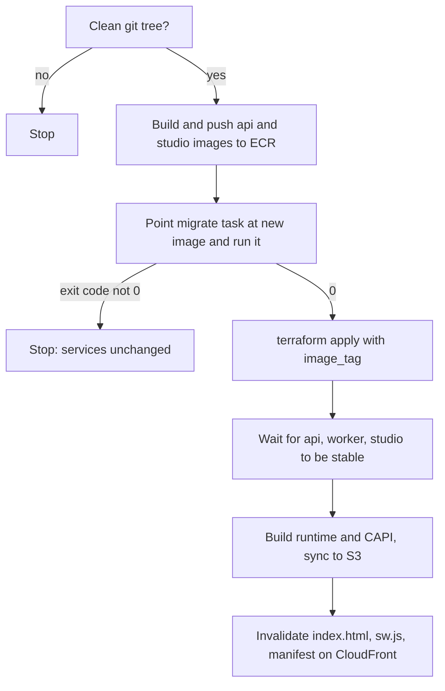

# Testing, deployment and maintenance

This file covers how ZAPX is tested, built, released, rolled back, backed up and monitored, and
what to do regularly to keep it healthy. Every section separates **Implemented** (exists in the
repository and was checked) from **Recommended** (not built yet).

The deeper guides it builds on: [infra/terraform/README.md](../../infra/terraform/README.md),
[docs/operations/go-live.md](../operations/go-live.md),
[docs/operations/database.md](../operations/database.md) and
[ADR 0009 local quality gates](../adr/0009-local-quality-gates.md).

## 1. Testing

### Implemented

| Layer                 | Tool                     | Where                                                                                                                               | Run it                                                                                               |
| --------------------- | ------------------------ | ----------------------------------------------------------------------------------------------------------------------------------- | ---------------------------------------------------------------------------------------------------- |
| Package unit tests    | Vitest                   | `packages/*/src/**/*.test.ts` (logic-engine 18 files, survey-schema 2, quality-core 2, analysis-core 3, redirect-core 1, quantum 1) | `pnpm test` or `pnpm --filter @zapx/logic-engine test`                                               |
| API integration tests | Vitest + a real database | `apps/api/test/*.test.ts` (one file per milestone or phase, 26 files)                                                               | `pnpm --filter @zapx/api test` (needs PostgreSQL at `DATABASE_URL`)                                  |
| End-to-end (browser)  | Playwright               | `e2e/tests/*.spec.ts` (29 files: `milestone*.spec.ts`, `blueprint*.spec.ts`, `quantum`, `neon`)                                     | `pnpm e2e` (builds must exist; starts API, studio, runtime and CAPI from `e2e/playwright.config.ts`) |
| Infrastructure        | `terraform test`         | `infra/terraform/tests/plan.tftest.hcl` (mocked provider)                                                                           | inside `pnpm check` when Terraform is installed                                                      |
| Static checks         | Prettier, ESLint, `tsc`  | `.prettierrc`, `eslint.config.*`, every `tsconfig.json`                                                                             | `pnpm format:check`, `pnpm lint`, `pnpm typecheck`                                                   |
| Secret scan           | own script               | `scripts/secret-scan.mjs`, also in the pre-commit hook `.githooks/`                                                                 | `pnpm secrets:scan`                                                                                  |
| Dependency audit      | `pnpm audit`             | accepted exceptions in [docs/security.md](../security.md)                                                                           | inside full `pnpm check`                                                                             |
| Everything at once    | `scripts/check.sh`       | —                                                                                                                                   | `pnpm check` / `--quick` / `--no-docker` / `--no-e2e`                                                |

Results at the time of writing (branch `blueprint-p5-enterprise`, run on 2026-11-05): `pnpm test`
passed **590 tests** (api 281, logic-engine 126, quantum 108, analysis-core 30, quality-core 21,
redirect-core 18, survey-schema 6). The Playwright suite was **not run** while writing this handbook.

The GitHub workflows `.github/workflows/ci.yml` and `codeql.yml` exist but **do not run**: the
repository is on the free plan without Actions (ADR 0009). `pnpm check` on your machine is the gate.

### How to test a change

1. `pnpm --filter <package> test` for the package you changed, while working.
2. Add or update a test in the same area: a package `*.test.ts`, an API `apps/api/test/*.test.ts`
   (they call the real Nest app with a real database), or a Playwright spec for a screen flow.
3. Before pushing: `pnpm check --quick` (format, lint, build, typecheck, migrations, all tests).
4. Before a release: full `pnpm check` (adds audit, Terraform, e2e and Docker images).

### Recommended (not implemented)

- **Studio component tests.** `apps/studio` has no unit tests; it is covered only by Playwright.
  Vitest + Testing Library for the form-heavy pages (survey editor, vendors, settings) would catch
  regressions faster.
- **Coverage report.** No coverage threshold is configured. `vitest run --coverage` per package
  would show untested areas.
- **Load test** of the respondent path (`/api/public/...`, `apps/api/src/interview/interview.controller.ts`) before a large launch, for example
  with k6, against staging only.
- **Restore test** on a schedule (see section 6).
- **Turn the GitHub workflows on** if the repository moves to a plan with Actions; they already
  mirror `pnpm check`.

## 2. Building

| What                     | Command                                   | Output                                                                                         |
| ------------------------ | ----------------------------------------- | ---------------------------------------------------------------------------------------------- |
| Everything               | `pnpm build`                              | `packages/*/dist`, `apps/api/dist`, `apps/studio/.next`, `apps/runtime/dist`, `apps/capi/dist` |
| One app and its packages | `pnpm --filter @zapx/api... build`        | same, for that app only (`...` includes its dependencies)                                      |
| Docker images            | `docker compose build`                    | images for every service in `docker-compose.yml`                                               |
| One image                | `docker build --target api -t zapx-api .` | targets: `api`, `migrate`, `worker`, `studio`, `runtime`, `capi`                               |

`Dockerfile` facts: base `node:22-bookworm-slim`; `api`, `migrate`, `worker` and `studio` run as
the unprivileged `node` user; `api` has a health check on `/api/health`; `migrate` runs
`apps/api/dist/cli/migrate.js` and exits; `worker` runs `apps/api/dist/worker.js`; `runtime` and
`capi` are static builds served by `nginx:1.27-alpine` with the headers in `infra/nginx/`.

## 3. Running a full stack with Docker (single server)

### Implemented

```bash
cp .env.example .env          # then set real secrets for anything beyond a laptop
docker compose up -d --build  # postgres, migrate (once), api, worker, studio, runtime, capi
docker compose ps
curl -s localhost:4000/api/health
```

Ports: studio 3000, API 4000, runtime 5173, CAPI 5174, PostgreSQL 5432. In this setup the `api`
service has `JOB_WORKER=off` and `CALLBACK_WORKER=off` and the `worker` service does the background
work.

**Needs Verification:** `docker-compose.yml` is written for development and evaluation. Using it for
production on one server needs at least `NODE_ENV=production`, `COOKIE_SECURE=true`, a real
`JWT_SECRET` and `SECRETS_KEY`, HTTPS in front (a reverse proxy) and a database backup job. That
path is not documented in the repository; AWS is the documented production target.

## 4. Releasing to AWS

### Implemented (written, validated, not yet applied)

- **Infrastructure:** `infra/terraform/` creates VPC, ALB, ECS Fargate services (API ×2, worker ×1,
  studio ×2, with autoscaling for API and studio), RDS PostgreSQL (Multi-AZ, 14-day backups in
  production), S3 buckets, CloudFront for the runtime and CAPI app, WAF (count mode first), KMS,
  Secrets Manager, AWS Backup (35 days), CloudWatch logs and alarms to SNS.
- **Release script:** `infra/scripts/deploy-aws.sh`.

The Terraform passes `terraform validate` and mocked plan tests, but **has never been applied to a
real AWS account**, and the release script has **never been run**. Both say so in their own headers.
Follow [docs/operations/go-live.md](../operations/go-live.md) in order and do everything on staging
first.

### First-time setup (summary of go-live.md)

1. Terraform state bucket, ACM certificates (one in us-east-1 for CloudFront), DNS validation.
2. `terraform apply` with `waf_mode = "count"` (`infra/terraform/<env>.tfvars`).
3. Put the app secret JSON in Secrets Manager. Every key in `app_secret_keys`
   (`infra/terraform/variables.tf`) must be present, including `TWILIO_AUTH_TOKEN` (empty string if
   unused); see [CONFIGURATION.md](CONFIGURATION.md#gaps-found).
4. First release (below), then create the first organization with a temporary
   `ALLOW_SIGNUP = "true"` and remove it again.

### Each release

```bash
git status                                  # must be clean: the image tag is the commit
pnpm check                                  # all gates green first
ENVIRONMENT=staging infra/scripts/deploy-aws.sh          # tag = current commit
ENVIRONMENT=staging infra/scripts/deploy-aws.sh <tag>    # or an explicit tag
```

What the script does, in order:



Order matters: migrations run **before** new code starts, so every migration must work with the
code that is still running (add columns as optional first, remove old ones in a later release).

### Checks after a release

```bash
curl -s https://<studio-domain>/api/health                  # {"ok":true}
aws ecs describe-services --cluster <cluster> --services api worker studio \
  --query 'services[].{name:serviceName,running:runningCount,desired:desiredCount,rollout:deployments[0].rolloutState}'
aws logs tail /zapx/<env>/api --since 15m
```

Then sign in to the studio, open one survey, and open one test link in the runtime.

## 5. Rolling back

### Implemented

- **Automatic:** ECS replaces new tasks that fail their health check and keeps the old ones
  (Terraform README, "Releasing").
- **Migrations failed:** the script stops before changing services, so nothing needs rolling back
  except the failed migration itself (see [TROUBLESHOOTING.md 5c](TROUBLESHOOTING.md#5c-migration-fails-p3009-failed-migrations-p3018)).

### Manual rollback to an earlier version

**Needs Verification** (derived from the script, not tested):

```bash
git checkout <previous-good-commit>          # so the runtime and CAPI builds match too
ENVIRONMENT=production infra/scripts/deploy-aws.sh "$(git rev-parse --short=12 HEAD)"
```

The script rebuilds and pushes images with that tag, runs migrations (already applied, so nothing
happens) and rolls the services back. **Database migrations are not undone.** Prisma has no "down"
migrations; if a release changed the schema in a way the old code cannot use, restore from backup
or write a new forward migration. Keep schema changes backward-compatible to avoid this.

### Recommended

- Keep a short list of released tags (for example a `RELEASES.md` or git tags `release-<date>`), so
  the previous good tag is known without searching.
- Add a `--skip-build` option to the script to reuse an image already in ECR for a faster rollback.

## 6. Backup and restore

### Implemented

| Environment        | How                                                                                                                                                    |
| ------------------ | ------------------------------------------------------------------------------------------------------------------------------------------------------ |
| Local / one server | `DATABASE_URL=... infra/scripts/backup.sh [dir]` writes `zapx-<UTC time>.dump` (pg_dump custom format) and keeps the newest `KEEP` (default 14).       |
| Restore            | `DATABASE_URL=<empty-db-url> infra/scripts/restore.sh <file>.dump` (pg_restore, stops on first error).                                                 |
| AWS                | RDS automated backups with point-in-time recovery (14 days in production) and AWS Backup for RDS and the files bucket (35 days), defined in Terraform. |

Targets written in [docs/operations/database.md](../operations/database.md): RPO ≤ 5 minutes, RTO
≤ 1 hour. They are targets, not measured values.

Rules:

- Restore **into a new, empty database**, never over the live one, then point a scratch stack at it.
- Files (exports, media, CAPI photos) are not in `pg_dump`. Locally they live in `FILES_DIR`
  (default `.data/files`); copy that folder too. On AWS they are in S3, covered by AWS Backup.

Restore drill (local):

```bash
createdb zapx_restore_test
DATABASE_URL=postgresql://<user>:<password>@localhost:5432/zapx_restore_test \
  infra/scripts/restore.sh backups/zapx-<timestamp>.dump
psql postgresql://<user>:<password>@localhost:5432/zapx_restore_test -c 'select count(*) from "Response"'
dropdb zapx_restore_test
```

### Recommended

- Run the restore drill monthly and write the time it took (that is your measured RTO).
- Cross-region backup copies (listed as "Not included yet" in the Terraform README).
- Schedule `backup.sh` with cron if you run on one server.

## 7. Production environment checklist

The API refuses to start in production without these (enforced in `apps/api/src/config.ts`):

- `NODE_ENV=production`, `COOKIE_SECURE=true`
- `JWT_SECRET` (32+ characters, not the example) and its own `SECRETS_KEY` (32+, not `JWT_SECRET`)
- `CALLBACK_ALLOW_PRIVATE_HOSTS` and `SSO_ALLOW_INSECURE_ISSUER` false
- `S3_BUCKET` when `FILE_STORE=s3`

Also set (not enforced, but needed): `STUDIO_URL` and `RUNTIME_BASE_URL`, `EDGE_SHARED_SECRET`
behind CloudFront, `TRUST_PROXY_HOPS` for the load balancer, `ALLOW_SIGNUP=false`, and the provider
keys you use. Full list: [CONFIGURATION.md](CONFIGURATION.md).

## 8. Monitoring

### Implemented

- **Health:** `GET /api/health` (database round trip). Used by the Docker `HEALTHCHECK`, the ECS
  container health check and the ALB target group.
- **Logs:** CloudWatch groups `/zapx/<env>/api`, `/worker`, `/studio`, `/migrate` (KMS-encrypted,
  retention `log_retention_days`); WAF logs `aws-waf-logs-zapx-<env>-edge` (us-east-1) and `-alb`.
- **Alarms** (`infra/terraform/monitoring.tf`, to an SNS topic): `api_5xx`, `api_unhealthy`
  (unhealthy targets), `db_cpu`, `db_storage` (free storage low).
- **In the app:** the audit log (Settings → Audit), vendor callback and webhook delivery logs, job
  status per survey, AI usage and budgets.

### Recommended

- Subscribe a real email or chat channel to the SNS topic on day one (the alarms do nothing
  otherwise).
- Alarms for **worker health** (no `JobWorker` log line in 10 minutes, or `Job` rows stuck in
  `QUEUED`), **dead callbacks** (`OutboundCallback.state = 'DEAD'`) and **API p95 latency** from the
  ALB.
- Structured JSON logs with a request id, so one request can be followed across API and worker.
- An external uptime check on the respondent runtime URL.

## 9. Maintenance recommendations

Regular tasks:

| How often     | Task                                                                                                      |
| ------------- | --------------------------------------------------------------------------------------------------------- |
| Every change  | `pnpm check --quick`; one PR per change; update the module guide or ADR when behaviour changes            |
| Weekly        | Review open Dependabot PRs (#20–#25 are open now); `pnpm audit --prod`                                    |
| Weekly        | Look at `DEAD` callbacks, `FAILED` jobs and the WAF counts during fieldwork                               |
| Monthly       | Restore drill; review members and API keys (revoke unused); check AI spend against budgets                |
| Quarterly     | Rotate `EDGE_SHARED_SECRET`, vendor and webhook secrets; review accepted advisories in `docs/security.md` |
| Before launch | Raise `api_max_count`; check the WAF rate limit for shared interview-centre addresses                     |

Improvements worth planning (details in [SECURITY_REVIEW.md](SECURITY_REVIEW.md)):

1. **Merge or close the open stack** (#27 → #34, and #28 separately). Eight unmerged branches make
   every fix harder; the longer they stay open the more conflicts they collect.
2. **Fix the documentation drift**: the root `README.md` and `docs/architecture.md` stop at
   milestone 13.
3. **Password reset**: there is no route to reset or change a password.
4. **Shared rate limiting**: the throttler is per process; with two or more API tasks the limits
   multiply. A shared store (database or Valkey) would make them exact.
5. **Studio unit tests** and a coverage report (section 1).
6. **Node 22 → newer LTS** when Dependabot PR #20 is reviewed; test with `pnpm check` and the Docker
   build.
7. **Re-check after PR #28 merges**: it moves integration keys into the CRM, which changes the
   Terraform secret list and [CONFIGURATION.md](CONFIGURATION.md).
