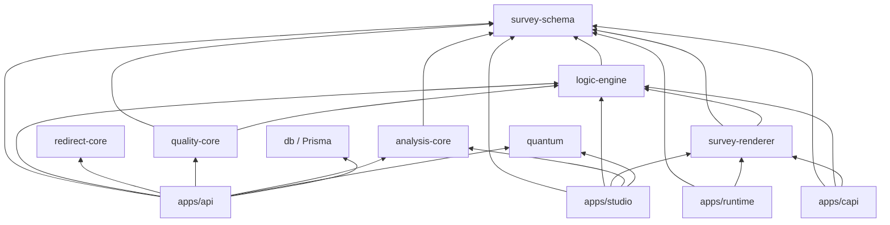

# File and folder structure

What every folder and important file is for, how files depend on each other, and which files to
change for a given feature. Branch `blueprint-p5-enterprise` (PR #34). Files added by the open PRs
are marked _(PR #NN)_.

Kinds used below: **config** (settings), **entry** (where a program starts), **controller** (HTTP
routes), **service** (business logic), **repository** (database access only), **guard / middleware**
(runs before every request), **component** (UI), **page** (UI route), **package** (shared library),
**schema** (data shape), **worker** (background loop), **test**, **infra** (deployment), **docs**.

## 1. Top-level tree

```
Sampledge-ZAPX/
├── apps/                       the four programs people run
│   ├── api/                    NestJS backend: all business logic and the REST API (/api, port 4000)
│   ├── studio/                 Next.js studio for research teams (port 3000)
│   ├── runtime/                respondent survey app, Vite + React (port 5173)
│   └── capi/                   offline interviewer app (PWA), Vite + React (port 5174)
├── packages/                   shared libraries used by the apps (no framework code)
│   ├── survey-schema/          THE survey definition format (Zod) + templates
│   ├── logic-engine/           expressions, routing, validation, QA simulation, XML, analysis helpers
│   ├── survey-renderer/        React question components (runtime, studio preview, CAPI)
│   ├── redirect-core/          redirect rules, status words, signing, callbacks, partner adapters
│   ├── quality-core/           quality score, fraud flags, fieldwork metrics
│   ├── analysis-core/          frequencies, crosstabs, significance, weighting, segments
│   ├── quantum/                studio theme engine and presets (PR #27)
│   └── db/                     Prisma schema, migrations, generated client, seed
├── e2e/                        Playwright browser tests through the real apps
├── docs/                       ADRs, module guides, API contracts, operations, this handbook
├── infra/                      nginx configs, backup/restore and AWS release scripts, Terraform
├── scripts/                    check.sh (quality gate), secret-scan.mjs, projexa-check.mjs
├── .github/                    CI and CodeQL workflows (not running on this account), Dependabot, PR template, CODEOWNERS
├── .githooks/                  pre-commit and pre-push secret scan
├── Dockerfile                  one multi-stage build → api, migrate, worker, studio, runtime, capi images
├── docker-compose.yml          the whole stack on one machine
├── .env.example                every setting with a safe local default (copy to .env)
├── package.json                root scripts: build, test, lint, check, db:migrate, db:seed, e2e
├── pnpm-workspace.yaml         which folders are workspace packages; security overrides
├── turbo.json                  task graph for build/test/typecheck across packages
├── tsconfig.base.json          shared TypeScript settings (strict)
├── eslint.config.mjs           lint rules
├── .prettierrc, .prettierignore formatting (printWidth 140)
├── README.md                   product overview by milestone (stops at M13; see SECURITY_REVIEW.md)
└── SECURITY.md                 how to report a vulnerability
```

### How the parts depend on each other



The arrows come from each `package.json`'s `dependencies`. Changing a package requires `pnpm build`
before the apps see the change, because apps import the built `dist/` output.

## 2. `apps/api` — the backend

**Entry points and configuration**

| File                                                 | Kind       | Responsibility                                                                                                  |
| ---------------------------------------------------- | ---------- | --------------------------------------------------------------------------------------------------------------- |
| `src/main.ts`                                        | entry      | starts the HTTP server on `API_PORT`                                                                            |
| `src/worker.ts`                                      | entry      | starts only the background loops (jobs, callbacks, webhooks); no HTTP                                           |
| `src/app.module.ts`                                  | config     | registers every controller and service, global guards, rate limit, JWT, the AI provider factory, the file store |
| `src/bootstrap.ts`                                   | middleware | cookies, JSON parsing, `/api` prefix, proxy trust, CDN edge trust, security headers                             |
| `src/config.ts`                                      | config     | reads and validates every environment variable; production safety checks                                        |
| `src/database-url.ts`                                | config     | builds `DATABASE_URL` from `DB_*` parts (AWS)                                                                   |
| `src/health.controller.ts`                           | controller | `GET /api/health` for load balancers and Docker                                                                 |
| `src/cli/migrate.ts`                                 | entry      | `node apps/api/dist/cli/migrate.js` — applies migrations (release step)                                         |
| `src/cli/set-plan.ts`                                | entry      | `node apps/api/dist/cli/set-plan.js <org id or email> <plan>`                                                   |
| `package.json`, `tsconfig*.json`, `vitest.config.ts` | config     | build with `tsc`, tests with Vitest + SWC                                                                       |

**Shared building blocks (`src/common`, `src/auth`, `src/platform`)**

| File                                                                          | Kind               | Responsibility · connects to                                                                    |
| ----------------------------------------------------------------------------- | ------------------ | ----------------------------------------------------------------------------------------------- |
| `common/common.module.ts`                                                     | config             | makes `PrismaService`, `AuditService`, `AccessService`, `PlanService` available everywhere      |
| `common/prisma.service.ts`                                                    | repository         | the database client; `forTenant()` for row-level security; RLS self-check at start              |
| `common/access.service.ts`                                                    | service            | **the** project/survey/vendor filters for project-level access; used by almost every controller |
| `common/audit.service.ts`                                                     | service            | writes `AuditEvent` rows                                                                        |
| `common/validation.ts`                                                        | utility            | `parseBody(schema, body)` → 400 with issues                                                     |
| `common/net-guard.ts`                                                         | utility            | SSRF guard for every outbound call to a customer address                                        |
| `common/send-bytes.ts`                                                        | utility            | sends files with byte-range support (audio/video seeking)                                       |
| `auth/auth.guard.ts`                                                          | guard              | global authentication + role check (see ARCHITECTURE §7)                                        |
| `auth/decorators.ts`                                                          | utility            | `@Public()`, `@Roles()`, `CAN_EDIT`, `ALL_ROLES`, `@CurrentUser()`                              |
| `auth/auth.types.ts`                                                          | types              | `AuthUser`, role names, cookie and CSRF header names, API key prefix                            |
| `auth/password-reset.service.ts`                                              | service            | password reset links (hash only, one use, expiry), reset emails _(branch `security-fixes`)_     |
| `auth/session.ts`                                                             | utility            | issues the 12-hour HS256 session and cookie                                                     |
| `auth/auth.controller.ts`                                                     | controller         | login (lockout), register, logout, logout-all, me                                               |
| `auth/password-policy.ts`                                                     | utility            | refuses common and patterned passwords                                                          |
| `auth/api-keys.ts`                                                            | utility            | API key format, hashing, constant-time comparison                                               |
| `auth/sso.controller.ts`, `sso.service.ts`, `saml.service.ts`, `sso-error.ts` | controller/service | OpenID Connect and SAML sign-in and the per-organization settings                               |
| `platform/secret-box.ts`                                                      | utility            | AES-256-GCM sealing of secrets ZAPX must read back (`SECRETS_KEY`)                              |

**Feature modules (`src/<folder>`)** — each folder has a controller (routes) and a service (logic).

| Folder          | Responsibility                                                                                                                                                                                                                                                                                                                                                                       | Change it for…                                           |
| --------------- | ------------------------------------------------------------------------------------------------------------------------------------------------------------------------------------------------------------------------------------------------------------------------------------------------------------------------------------------------------------------------------------ | -------------------------------------------------------- |
| `users/`        | team members (`users.controller.ts`); personal and organization appearance, workspace presets (`preferences.controller.ts`, PR #27/#34)                                                                                                                                                                                                                                              | adding/disabling members, role rules, appearance storage |
| `projects/`     | projects CRUD and soft delete; project members (`members.controller.ts`)                                                                                                                                                                                                                                                                                                             | project fields, project access                           |
| `surveys/`      | survey create, draft save, check, publish, status, versions, quotas, responses list, links, small export (`surveys.controller.ts`, `surveys.service.ts`); AI and manual translation (`translate.controller.ts`); glossary, translation memory, translation QA (`translation-tools.controller.ts`, PR #31)                                                                            | survey lifecycle, publish rules, link format             |
| `vendors/`      | vendor CRUD, secret rotation, redirect preview, presets                                                                                                                                                                                                                                                                                                                              | vendor settings                                          |
| `interview/`    | the respondent flow (start, answer, back, language)                                                                                                                                                                                                                                                                                                                                  | anything respondents experience                          |
| `quotas/`       | `quota-places.ts`: atomic quota take/release, least-fill groups (PR #33)                                                                                                                                                                                                                                                                                                             | quota counting                                           |
| `integrations/` | redirect resolution (`redirect.service.ts`), all its DB access (`redirect.repository.ts`), settings mapping (`integration-config.ts`), callback outbox worker (`callback.worker.ts`, `http-delivery.ts`), webhooks (`webhook.service.ts`, `webhook-signing.ts`, `webhooks.controller.ts`), vendor API (`vendor-api.controller.ts`), logs and defaults (`integrations.controller.ts`) | redirects, callbacks, webhooks, the partner API          |
| `ai/`           | `ai-gateway.ts` (every AI call: model per task, permissions, rate/budget limits, breaker, redaction, usage), `ai-provider.ts` (interface), `claude.provider.ts`, `architect.service.ts`, `propose.service.ts`, `prompts.ts`, `redact.ts`, `circuit-breaker.ts`, `ai-usage.repository.ts`, `ai-settings.controller.ts`                                                                | AI behaviour, prompts, adding a provider                 |
| `imports/`      | `documents.ts` (file type by content), `template-import.ts` (ZAPX Excel/CSV template)                                                                                                                                                                                                                                                                                                | import formats                                           |
| `changesets/`   | proposals from AI, import or paste; diff, check, QA preview; apply/reject                                                                                                                                                                                                                                                                                                            | review workflow                                          |
| `qa/`           | QA lab runs (`qa.service.ts`) and saved test cases (`test-cases.controller.ts`, PR #31)                                                                                                                                                                                                                                                                                              | QA lab                                                   |
| `quality/`      | quality scoring and review queue (`quality.service.ts`), fraud blocks, IPinfo (`network-reputation.service.ts`)                                                                                                                                                                                                                                                                      | quality rules, review decisions                          |
| `captures/`     | photos and recordings (`capture.service.ts`), Deepgram transcripts (`transcription.service.ts`)                                                                                                                                                                                                                                                                                      | private files of interviews                              |
| `capi/`         | interviewer assignments, survey package download, sync with server replay (`capi.service.ts`)                                                                                                                                                                                                                                                                                        | offline interviewing server side                         |
| `fieldwork/`    | supervisor dashboard, back-checks, appeals (PR #32)                                                                                                                                                                                                                                                                                                                                  | CAPI supervision                                         |
| `cati/`         | call lists and queue (`cati.service.ts`), calling hours and do-not-call (`calling-rules.ts`), Twilio dialer and webhooks (`telephony.*`)                                                                                                                                                                                                                                             | phone interviewing                                       |
| `distribution/` | contacts, invitation waves, reminders, unsubscribe (`distribution.service.ts`), SendGrid (`mailer.ts`, PR #32), Twilio SMS (`sms.ts`, PR #34)                                                                                                                                                                                                                                        | email/SMS invitations                                    |
| `exports/`      | builds CSV/XLSX (`export.service.ts`); sync vs background decision (`export-runner.service.ts`)                                                                                                                                                                                                                                                                                      | export columns and format                                |
| `analysis/`     | frequencies, crosstabs, weights, dashboards, choice models, reports (`analysis.service.ts`); AI research assistant (`research.service.ts`, PR #33)                                                                                                                                                                                                                                   | analysis and reports                                     |
| `dashboard/`    | home screen numbers and search (PR #29)                                                                                                                                                                                                                                                                                                                                              | home dashboard                                           |
| `media/`        | survey media upload and public serving                                                                                                                                                                                                                                                                                                                                               | images/video/audio in surveys                            |
| `jobs/`         | job queue (`jobs.service.ts`, `jobs.controller.ts`), worker loop and housekeeping (`job.worker.ts`), stored files (`files.service.ts`), local/S3 store (`file-store.ts`)                                                                                                                                                                                                             | background work, files                                   |
| `library/`      | question bank and templates (PR #30)                                                                                                                                                                                                                                                                                                                                                 | reusable content                                         |
| `enterprise/`   | API keys, audit log viewer and CSV, RLS status                                                                                                                                                                                                                                                                                                                                       | integration keys, audit                                  |
| `plans/`        | plan limits (`plans.ts`), usage checks (`plan.service.ts`), Stripe (`billing.*`)                                                                                                                                                                                                                                                                                                     | plans, billing                                           |
| `scim/`         | SCIM 2.0 users API, token admin, guard, errors                                                                                                                                                                                                                                                                                                                                       | identity provisioning                                    |
| `automation/`   | rule language (`automation-rules.ts`), event → runs (`automation.queue.ts`), engine (`automation.service.ts`), notifications (PR #34)                                                                                                                                                                                                                                                | automation                                               |
| `governance/`   | residency and retention (PR #34)                                                                                                                                                                                                                                                                                                                                                     | data retention                                           |

**Tests (`apps/api/test`)**: one file per milestone (`m2.test.ts` … `m20.test.ts`), per blueprint
phase (`blueprint.test.ts` … `blueprint5.test.ts`), `api.test.ts` (M1), `dashboard.test.ts`,
`quantum.test.ts`. They boot the real Nest app against the database in `.env` and call it with
Supertest. `test/support/` has mock OIDC, SAML and S3 servers.

## 3. `apps/studio` — the research team's web app

| Path                                                                                  | Kind      | Responsibility                                                                                              |
| ------------------------------------------------------------------------------------- | --------- | ----------------------------------------------------------------------------------------------------------- |
| `next.config.mjs`                                                                     | config    | proxies `/api/*` to `ZAPX_API_URL` (default `http://localhost:4000`); security headers                      |
| `app/layout.tsx`                                                                      | page      | HTML shell, default theme CSS, theme boot script, `ThemeProvider`                                           |
| `app/globals.css`, `app/quantum.css`, `app/neon.css`                                  | style     | all studio CSS (custom properties; `neon.css` is PR #29)                                                    |
| `app/page.tsx`                                                                        | page      | dashboard (PR #29)                                                                                          |
| `app/login/page.tsx`                                                                  | page      | sign-in / sign-up / SSO                                                                                     |
| `app/forgot-password/page.tsx`, `app/reset-password/page.tsx`, `app/account/page.tsx` | page      | password reset and change _(branch `security-fixes`)_                                                       |
| `app/projects/page.tsx`, `app/projects/[id]/page.tsx`                                 | page      | project list, one project (surveys, vendors, access)                                                        |
| `app/surveys/[id]/page.tsx`                                                           | page      | **survey workspace**: loads survey + draft, holds unsaved state, saves, publishes, renders the tabs         |
| `app/library/page.tsx`                                                                | page      | question bank (PR #30)                                                                                      |
| `app/calls/page.tsx`                                                                  | page      | CATI calling screen                                                                                         |
| `app/automation/page.tsx`                                                             | page      | automation (PR #34)                                                                                         |
| `app/appearance/page.tsx`, `ComponentPreview.tsx`                                     | page      | themes (PR #27)                                                                                             |
| `app/settings/page.tsx`                                                               | page      | settings hub (AI, redirect defaults) and embeds `Team`, `ApiKeys`, `Webhooks`, `Identity`, `DataGovernance` |
| `app/settings/audit/page.tsx`                                                         | page      | audit log                                                                                                   |
| `lib/api.ts`                                                                          | utility   | `api()` and `upload()` fetch wrappers, `ApiError`, shared response types                                    |
| `lib/useMe.ts`                                                                        | utility   | loads the signed-in member (`GET /api/auth/me`)                                                             |
| `lib/theme/ThemeProvider.tsx`                                                         | utility   | applies appearance, area themes (PR #27/#34)                                                                |
| `components/Shell.tsx`                                                                | component | sidebar, top bar, plan card, sign-out; `ErrorNote`                                                          |
| `components/quantum/*`                                                                | component | design-system primitives (Button, Switch, ThemeMenu …) (PR #27)                                             |
| `components/neon/*`                                                                   | component | dashboard widgets, charts, global search, create-survey form (PR #29)                                       |

Survey workspace components (one per tab or panel):

| Component                                                                                            | Tab / place                                                        | Talks to                                                                                                                            |
| ---------------------------------------------------------------------------------------------------- | ------------------------------------------------------------------ | ----------------------------------------------------------------------------------------------------------------------------------- |
| `VisualEditor.tsx`                                                                                   | Build                                                              | edits the definition in memory; saved by the page                                                                                   |
| `FlowEditor.tsx`                                                                                     | Build (loops, blocks, variables, URL variables, recodes, cleaning) | definition (PR #30–#34)                                                                                                             |
| `ChoiceForms.tsx`                                                                                    | Build (MaxDiff/conjoint)                                           | definition (PR #33)                                                                                                                 |
| `QuestionBank.tsx`                                                                                   | Build sidebar                                                      | `/api/library` (PR #30)                                                                                                             |
| `MediaLibrary.tsx`                                                                                   | Build                                                              | `/api/surveys/:id/media`                                                                                                            |
| `Programmer.tsx`, `CodeEditor.tsx`                                                                   | Code (XML, debugger)                                               | logic engine in the browser; `/api/library` (PR #30)                                                                                |
| `Assist.tsx`, `VoiceCommand.tsx`                                                                     | AI & import                                                        | `/api/surveys/:id/ai/propose`, `/import`, `/changesets`                                                                             |
| `DesignStudio.tsx`                                                                                   | Design                                                             | presentation (theme, devices)                                                                                                       |
| `Languages.tsx`, `Glossary.tsx`                                                                      | Languages                                                          | `/translate`, `/translation-qa`, `/translation-memory`, `/glossary`                                                                 |
| `Preview.tsx`                                                                                        | Preview                                                            | runs the draft in the browser with the logic engine; device matrix (PR #33)                                                         |
| `QaLab.tsx`, `TestCases.tsx`                                                                         | QA lab                                                             | `/qa/run`, `/jobs/qa`, `/test-cases`                                                                                                |
| `EmailInvitations.tsx`                                                                               | Distribution                                                       | `/contacts`, `/distributions` (PR #32/#34)                                                                                          |
| `VendorEditor.tsx`, `RedirectRules.tsx`                                                              | project page                                                       | `/vendors`, `/callbacks`, `/redirect-defaults`                                                                                      |
| `CapiAssignments.tsx`, `Supervisor.tsx`, `CatiCalls.tsx`                                             | Interviewers                                                       | `/capi/assignments`, `/supervisor`, `/backchecks`, `/appeals`, `/cati/*`                                                            |
| `Quality.tsx`                                                                                        | Quality & fieldwork                                                | `/quality`, `/fieldwork`, `/captures`, `/quality/blocks`                                                                            |
| `ExportJobs.tsx`                                                                                     | Quotas & data                                                      | `/jobs/export`, `/jobs/:id`, `/files/:id`                                                                                           |
| `Analysis.tsx`, `ChoiceResults.tsx`, `ResearchAssistant.tsx`                                         | Analysis                                                           | `/analysis/*`, `/reports/*`                                                                                                         |
| `Team.tsx`, `ProjectAccess.tsx`, `ApiKeys.tsx`, `Webhooks.tsx`, `Identity.tsx`, `DataGovernance.tsx` | Settings                                                           | `/users`, `/projects/:id/members`, `/api-keys`, `/webhooks`, `/sso`, `/scim/token`, `/plan`, `/billing`, `/organization/governance` |
| `NotificationBell.tsx`                                                                               | top bar                                                            | `/notifications` (PR #34)                                                                                                           |

## 4. `apps/runtime` — respondent app

| File             | Responsibility                                                                                                                                                                                      |
| ---------------- | --------------------------------------------------------------------------------------------------------------------------------------------------------------------------------------------------- |
| `src/App.tsx`    | reads `/s/:surveyId` or `/r/:token`, calls the public API, renders the page with `survey-renderer`, sends page signals (honeypot, paste, interactions), handles photo upload and the final redirect |
| `src/main.tsx`   | mounts React                                                                                                                                                                                        |
| `vite.config.ts` | dev/preview proxy for `/api`                                                                                                                                                                        |
| `index.html`     | page shell                                                                                                                                                                                          |

In production nginx serves the built files with `infra/nginx/runtime.conf` (SPA fallback, `/api`
proxy) and `runtime-headers.conf`.

## 5. `apps/capi` — offline interviewer app

| File                                      | Responsibility                                                                      |
| ----------------------------------------- | ----------------------------------------------------------------------------------- |
| `src/App.tsx`                             | sign-in, list of assigned surveys, download, sync, my interviews and appeals        |
| `src/Interview.tsx`                       | runs one interview on the device with the logic engine; saves after every page      |
| `src/store.ts`                            | IndexedDB: survey packages, interviews, captures, device id                         |
| `src/api.ts`                              | the only network code: login, package download, media caching, capture upload, sync |
| `src/capture.ts`                          | GPS, consented audio/video recording, evidence timers                               |
| `public/sw.js`                            | service worker: app shell cache, media cache                                        |
| `public/manifest.webmanifest`, `icon.svg` | installable app metadata                                                            |

## 6. `packages/` — shared libraries

| Package           | Key files                                                                                                                                                                                                                                                                                                                                                                                                                       | Responsibility                                                     |
| ----------------- | ------------------------------------------------------------------------------------------------------------------------------------------------------------------------------------------------------------------------------------------------------------------------------------------------------------------------------------------------------------------------------------------------------------------------------- | ------------------------------------------------------------------ |
| `survey-schema`   | `src/index.ts` (all schemas: questions, pages, quotas, loops, blocks, variables, recodes, cleaning, quality, CAPI settings, presentation, test cases), `src/templates.ts`                                                                                                                                                                                                                                                       | the canonical survey format and its parser `parseSurveyDefinition` |
| `logic-engine`    | `expression.ts` (expression language, no `eval`), `interview.ts` (next page, validation, terminations), `flow.ts` (loops, blocks), `analyze.ts` (logic check), `simulate.ts` (QA lab), `replay.ts` (CAPI replay), `localize.ts` (translations), `diff.ts`, `xml.ts`, `debug.ts`, `device.ts`, `quota-table.ts`, `choice-*.ts`, `cleaning.ts`, `suggest-cases.ts`, `translation-tools.ts`, `voice.ts`, `geo.ts`, `bank-block.ts` | all survey logic, used by server, studio and CAPI                  |
| `survey-renderer` | `src/index.tsx` (one 1,591-line file)                                                                                                                                                                                                                                                                                                                                                                                           | every question component, theme CSS, page signals                  |
| `redirect-core`   | `statuses.ts`, `layers.ts` (precedence), `template.ts` (placeholders, allowed hosts), `signing.ts`, `callbacks.ts` (retry policy), `adapters.ts` (DIRECT, PROJEXA), `presets.ts` (Sampledge preset)                                                                                                                                                                                                                             | redirects and partner contracts; no database                       |
| `quality-core`    | `assess.ts`, `open-ends.ts`, `fieldwork.ts`                                                                                                                                                                                                                                                                                                                                                                                     | quality score and fieldwork metrics; no database                   |
| `analysis-core`   | `index.ts` (variables, frequencies, crosstabs, significance, segments), `weighting.ts` (raking)                                                                                                                                                                                                                                                                                                                                 | statistics; no database                                            |
| `quantum`         | `presets.ts`, `engine.ts`, `color.ts`, `appearance.ts`, `boot.ts` (PR #27–#34)                                                                                                                                                                                                                                                                                                                                                  | studio theme tokens with contrast enforcement                      |
| `db`              | `prisma/schema.prisma`, `prisma/migrations/*`, `src/seed.ts`, `src/index.ts`                                                                                                                                                                                                                                                                                                                                                    | database schema, migrations, client                                |

Unit tests sit next to the code as `*.test.ts` (Vitest).

## 7. `e2e`, `infra`, `scripts`, `docs`

| Path                                         | Responsibility                                                                                                               |
| -------------------------------------------- | ---------------------------------------------------------------------------------------------------------------------------- |
| `e2e/playwright.config.ts`                   | starts the built API, studio, runtime and CAPI app with test settings (stand-ins for Deepgram and Twilio)                    |
| `e2e/tests/*.spec.ts`                        | one browser test per milestone/phase; `e2e/fixtures/` media files                                                            |
| `infra/nginx/*.conf`                         | runtime and CAPI static hosting, `/api` proxy, security headers                                                              |
| `infra/scripts/backup.sh`, `restore.sh`      | `pg_dump` / `pg_restore` of the database                                                                                     |
| `infra/scripts/deploy-aws.sh`                | release to AWS (build, push, migrate, roll out, publish static apps)                                                         |
| `infra/terraform/*.tf`                       | AWS: network, ECS, RDS, S3, CloudFront, WAF, autoscaling, backups, monitoring; `tests/plan.tftest.hcl`                       |
| `scripts/check.sh`                           | `pnpm check`: the full local quality gate                                                                                    |
| `scripts/secret-scan.mjs`                    | blocks secrets in commits (hooks and `pnpm check`)                                                                           |
| `scripts/projexa-check.mjs`                  | end-to-end check of the PROJEXA contract                                                                                     |
| `docs/adr/`                                  | architecture decisions 0001–0033                                                                                             |
| `docs/modules/`                              | module guides (redirects, AI gateway, data quality, CAPI, CATI, analytics, jobs, SSO, billing, webhooks, rich media, access) |
| `docs/api/openapi.yaml`, `capi-openapi.yaml` | partner (vendor) API and CAPI API contracts                                                                                  |
| `docs/operations/`                           | database operations, go-live steps, GitHub security settings                                                                 |
| `docs/product/blueprint-parity.md`           | the blueprint feature matrix                                                                                                 |
| `docs/handbook/`                             | this handbook                                                                                                                |

## 8. Which files to change for a feature

| Change                                 | Files, in order                                                                                                                                                                                                                                                                                                                                       |
| -------------------------------------- | ----------------------------------------------------------------------------------------------------------------------------------------------------------------------------------------------------------------------------------------------------------------------------------------------------------------------------------------------------- |
| New question type                      | `packages/survey-schema/src/index.ts` (schema + union) → `packages/logic-engine/src/interview.ts` (validation), `analyze.ts`, `simulate.ts`, `localize.ts`, `xml.ts` → `packages/survey-renderer/src/index.tsx` → `apps/studio/components/VisualEditor.tsx` → `apps/api/src/exports/export.service.ts`, `packages/analysis-core/src/index.ts` → tests |
| New survey-level setting               | `survey-schema` (`surveyDefinitionSchema.settings`) → logic engine where it is used → `VisualEditor.tsx` or `FlowEditor.tsx`                                                                                                                                                                                                                          |
| New respondent rule (e.g. entry check) | `apps/api/src/interview/interview.service.ts` (`start` / `submitFor`), maybe `packages/logic-engine/src/interview.ts`                                                                                                                                                                                                                                 |
| New outcome redirect behaviour         | `packages/redirect-core/src/*` → `apps/api/src/integrations/integration-config.ts`, `redirect.service.ts` → `VendorEditor.tsx`                                                                                                                                                                                                                        |
| New vendor field                       | `schema.prisma` `Vendor` + migration → `apps/api/src/vendors/vendors.controller.ts` (zod schema and select) → `integration-config.ts` → `VendorEditor.tsx`                                                                                                                                                                                            |
| New quality check                      | `packages/quality-core/src/assess.ts` → `survey-schema` `qualitySettingsSchema` (if configurable) → `apps/api/src/quality/quality.service.ts` → `Quality.tsx`                                                                                                                                                                                         |
| New export column                      | `apps/api/src/exports/export.service.ts`                                                                                                                                                                                                                                                                                                              |
| New analysis statistic                 | `packages/analysis-core/src/index.ts` → `apps/api/src/analysis/analysis.service.ts` → `apps/studio/components/Analysis.tsx`                                                                                                                                                                                                                           |
| New background job type                | `apps/api/src/jobs/job.worker.ts` (`JOB_TYPES`, `handle`) → `jobs.controller.ts` (enqueue route) → studio component using `/jobs/:id`                                                                                                                                                                                                                 |
| New webhook event                      | `apps/api/src/integrations/webhook.service.ts` (`WEBHOOK_EVENTS`, emit) → `apps/api/src/automation/automation-rules.ts` (if rules should listen) → `docs/modules/webhooks.md`                                                                                                                                                                         |
| New environment variable               | `apps/api/src/config.ts` → `.env.example` → `infra/terraform` (`app_environment` or secret) → [CONFIGURATION.md](CONFIGURATION.md)                                                                                                                                                                                                                    |
| New studio page                        | `apps/studio/app/<route>/page.tsx` → `components/Shell.tsx` (menu item)                                                                                                                                                                                                                                                                               |
| New setting on the Settings page       | component in `apps/studio/components/` → embed in `apps/studio/app/settings/page.tsx` → API controller                                                                                                                                                                                                                                                |
| New AI task                            | `apps/api/src/ai/ai-gateway.ts` (`AI_TASKS`), `config.ts` (`AI_MODEL_<TASK>`), a service using `AiGateway.run`, `TenantAiPolicy.allowedTasks` default                                                                                                                                                                                                 |
